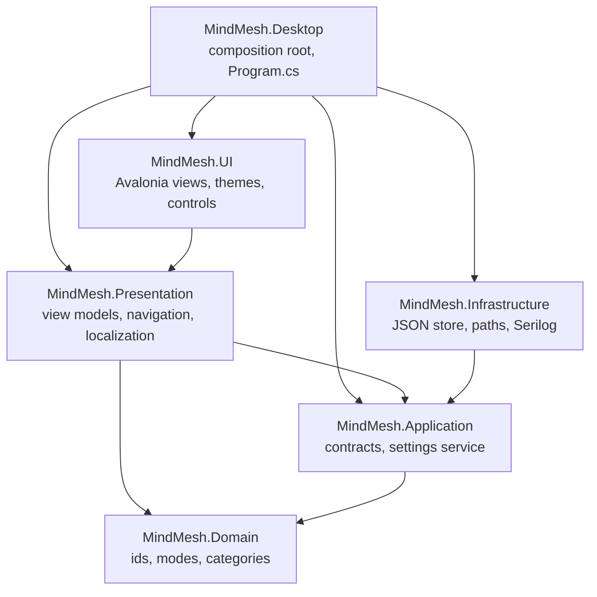
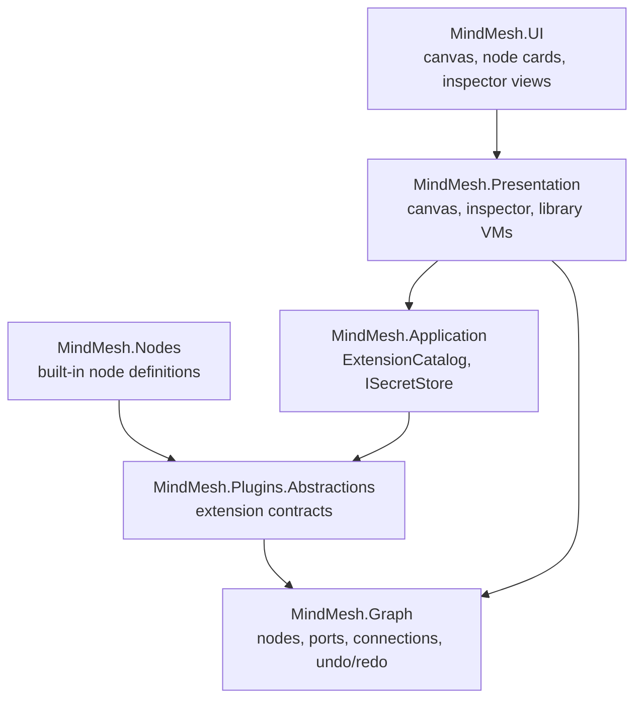

# MindMesh — архитектура (состояние после Phase 2)

Документ описывает то, что **уже есть в репозитории**, и отдельно помечает то, что **запланировано** на следующие фазы.
Всё, что помечено «Phase N», в коде отсутствует и не имитируется заглушками: соответствующие экраны и кнопки
показывают, в какой фазе они появятся, а действия отключены.

## 1. Структура решения

```
MindMesh.slnx
├─ Directory.Build.props          общие настройки сборки (net11.0, C# latest, nullable, версия 0.1.0-alpha.1)
├─ Directory.Packages.props       централизованные версии NuGet-пакетов
├─ global.json                    версия SDK
├─ .editorconfig / .gitattributes табы, CRLF, UTF-8
├─ src/
│  ├─ Core/
│  │  ├─ MindMesh.Domain          идентификаторы, режимы редактора, категории нод (без зависимостей)
│  │  └─ MindMesh.Application     контракты и сценарии: настройки, языки, пути, сведения о приложении
│  ├─ Infrastructure/
│  │  └─ MindMesh.Infrastructure  файловое хранилище настроек (JSON), пути, логирование (Serilog), хост-хуки
│  └─ Desktop/
│     ├─ MindMesh.Presentation    view-модели, навигация, локализация (без Avalonia, тестируется без UI)
│     ├─ MindMesh.UI              вид: темы, стили, контролы, иконки, XAML-представления
│     └─ MindMesh.Desktop         точка входа (WinExe), композиция DI, запуск Avalonia
├─ tests/
│  ├─ MindMesh.Domain.Tests
│  ├─ MindMesh.Application.Tests
│  ├─ MindMesh.Infrastructure.Tests
│  ├─ MindMesh.Presentation.Tests
│  └─ MindMesh.UI.Tests
└─ docs/architecture/             этот документ и отчёт по фазе
```

**Отличия от списка проектов в мастер-промпте** (согласовано заранее): выбран компактный набор. `UI.Controls`
слит в `MindMesh.UI`. Проекты `Graph`, `Workflow`, `Runtime`, `Nodes`, `Plugins`, `Backend`, `Worker`
и остальные создаются в фазах, где у них появляется содержимое, а не пустыми оболочками.

## 2. Схема архитектуры



Правила зависимостей:

- `Domain` ни от чего не зависит; `Application` знает только `Domain`.
- `Infrastructure` реализует интерфейсы `Application`; `Application` о ней не знает.
- `Presentation` не ссылается на Avalonia — поэтому всё поведение окон и страниц проверяется обычными xunit-тестами.
- Только `Desktop` знает обо всех слоях и собирает контейнер зависимостей.

Жизненный цикл запуска (`Program.Main`):

1. `Host.CreateApplicationBuilder`: конфигурация, DI, Serilog (файл `logs/mindmesh-.log`, ротация по дням).
2. `host.Start()` → `SettingsLifecycleService.StartAsync` загружает настройки до создания окна.
3. Регистрируется запись необработанных исключений в лог.
4. `StartWithClassicDesktopLifetime` создаёт `MainWindow` с `MainWindowViewModel`.
5. При выходе `StopAsync` сохраняет отложенные изменения настроек, затем `Log.CloseAndFlush()`.

## 3. Основные контракты между проектами

| Контракт | Проект | Назначение |
|---|---|---|
| `IAppInfo` | Application | имя, версия, copyright |
| `IAppPaths` | Application | каталоги данных, логов, файл настроек |
| `IAppSettingsStore` | Application | загрузка и сохранение `AppSettings` (реализует `JsonAppSettingsStore`) |
| `ISettingsService` | Application | текущие настройки, `Changed`, `Update`, отложенное сохранение, `FlushAsync` |
| `ILocalizer` | Presentation | тексты по ключу, смена языка «на лету» через `Item[]` |
| `INavigationService` | Presentation | текущая страница, `NavigateTo(PageKey)` |
| `IPageFactory` | Presentation | создание страницы по `PageKey` (`PageRegistration`) |

Договорённости:

- Долгие асинхронные операции принимают `CancellationToken` (`InitializeAsync`, `FlushAsync`, `LoadAsync`, `SaveAsync`).
- Запись настроек атомарна (временный файл + `File.Move`); повреждённый файл переименовывается в `settings.json.corrupt`,
  приложение стартует с настройками по умолчанию.
- `SettingsService.Update` нормализует значения, не вызывает событие и не пишет на диск, если ничего не изменилось;
  несколько быстрых изменений сохраняются одной записью через 500 мс.

## 4. Модель сущностей

Реализовано в Phase 1:

| Сущность | Слой | Описание |
|---|---|---|
| `ProjectId`, `WorkflowId` | Domain | `readonly record struct` над `Guid` (version 7), `New/Parse/Empty/IsEmpty` |
| `WorkflowMode` | Domain | `Workflow`, `AiAgent`, `DataFlow`, `Logic` |
| `NodeCategory` | Domain | 32 категории нод; каждая принадлежит ровно одному режиму (`WorkflowModeCatalog`) |
| `AppSettings` | Application | версия схемы, язык, тема, показ приветствия, `LayoutSettings` |
| `LayoutSettings` | Application | видимость и размеры панелей редактора, компактный сайдбар |
| `AppLanguage` | Application | код и родное название языка (`en`, `ru`) |

Запланировано (не реализовано): `Project`, `Workflow`, `Node`, `Port`, `Edge`, `Variable`, `Execution`, `ExecutionStep`,
`Plugin`, `Template`, `User` — по фазам 2–9 мастер-промпта.

## 5. Структура UI

```
MainWindow
├─ TopBarView           логотип · «проект / workflow» · статус сохранения · тулбар редактора · меню пользователя
├─ SidebarView          Проекты · Workflows · Шаблоны · Marketplace · Executions · Плагины · (внизу) Настройки;
│                       обычный и компактный режим
└─ ContentControl (Navigation.CurrentPage)
   ├─ WelcomePageView
   ├─ EditorPageView    библиотека нод | холст (сетка) + консоль | инспектор | AI-ассистент
   │                    панели скрываются и меняют размер (PanelResizer), состояние сохраняется
   ├─ SettingsPageView  язык (Авто / English / Русский), сброс раскладки, каталоги данных
   ├─ AboutPageView
   └─ PlaceholderPageView  Проекты (Phase 3), Executions (Phase 5), Шаблоны / Marketplace / Плагины (Phase 9)
```

Дизайн-система собственная, поверх встроенной `FluentTheme`:

- `Themes/MindMeshColors.axaml` — палитра (`MM.Color.*`), `MindMeshTokens.axaml` — размеры, радиусы, шрифты,
  `MindMeshStyles.axaml` — классы стилей (`h1…h3`, `panel`, `card`, `nav`, `primary` и т. д.).
- Светлая тема по умолчанию, тёмная переключается в настройках (отдельные словари цветов, разметка общая).
- Контролы: `Icon` (штриховые иконки из `IconCatalog`), `EmptyState`, `CanvasGridBackground` (сетка с учётом zoom/offset),
  `PanelResizer`.
- Привязки компилируются (`x:DataType` везде). Тексты — `{Binding Loc[Ключ]}`; ключи проверяются тестом.

## 6. NuGet-пакеты и обоснование

| Пакет | Версия | Где | Зачем |
|---|---|---|---|
| Avalonia, Avalonia.Desktop, Avalonia.Themes.Fluent | 12.1.5 | UI, Desktop | кроссплатформенный UI; версия задана заказчиком |
| Tmds.DBus.Protocol | 0.95.2 | Desktop | транзитивная зависимость Avalonia.Desktop на Linux; закреплена выше уязвимого диапазона (GHSA-xrw6-gwf8-vvr9, < 0.92.0) |
| CommunityToolkit.Mvvm | 8.4.2 | Presentation | генераторы `[ObservableProperty]`, `[RelayCommand]` без шаблонного кода |
| Microsoft.Extensions.Hosting | 10.0.14 | Desktop | единый хост: DI, конфигурация, жизненный цикл |
| Microsoft.Extensions.Hosting.Abstractions | 10.0.14 | Infrastructure | `IHostedService` без полного хоста |
| Microsoft.Extensions.DependencyInjection(.Abstractions) | 10.0.14 | Application, Presentation, Infrastructure | регистрация сервисов расширениями слоёв |
| Microsoft.Extensions.Logging.Abstractions | 10.0.14 | Application, Presentation | `ILogger<T>` без привязки к провайдеру |
| Serilog.Extensions.Hosting | 10.0.0 | Infrastructure | подключение Serilog к `Microsoft.Extensions.Logging` |
| Serilog.Sinks.File | 6.0.0 | Infrastructure | файл лога с ротацией по дням |
| Microsoft.NET.Test.Sdk, xunit.v3, xunit.runner.visualstudio | 18.11.0 / 4.0.3 / 4.0.1 | tests | тесты (тестовые проекты xunit.v3 — исполняемые, `OutputType=Exe`) |

Сознательно не используются: FluentAvalonia (свои стили), ReactiveUI (достаточно CommunityToolkit.Mvvm),
EF Core и ASP.NET Core (появятся с backend в Phase 8), моки (достаточно рукописных fake-ов).

Номера версий пакетов не проверялись сборкой — см. `phase-1-report.md`.

## 7. Phase 2 — граф-редактор

Добавлено поверх Phase 1 (подробности и ограничения — `phase-2-report.md`):



- `Graph` не зависит от UI; определение ноды, состояние графа и состояние редактора разделены.
- Точки расширения — только контракты (`Plugins.Abstractions`); лицензирование и монетизация сюда не входят.
- Холст: контролы с трансформацией pan/zoom + `DrawingContext`; вся геометрия и hit-testing — в `Presentation` (тестируется без UI).
- Параметры нод хранятся как `ParameterValue` (JSON); секреты — только ссылкой в `ISecretStore`.
- Новые пакеты: AvaloniaEdit (редакторы Code/Expression/JSON в инспекторе).
